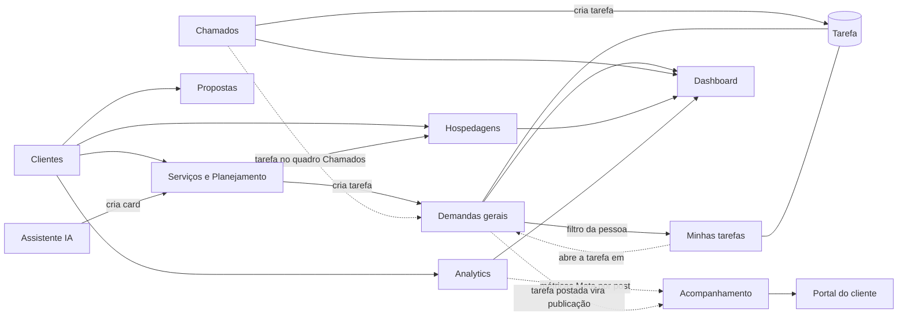

# Cérebro do Sistema VIVOX

> O mapa de tudo: quais seções existem, o que cada uma faz, que dados elas
> compartilham e como uma alimenta a outra. Comece por aqui.
> Validado contra a `main` em **2026-10-20**. Se algo aqui contradiz o código,
> o código vence: corrija este arquivo no mesmo PR.

## Como os documentos se organizam

| Arquivo | Para que serve | Quando atualizar |
|---|---|---|
| **`docs/CEREBRO.md`** (este) | Mapa das seções e como elas se cruzam | Quando uma mudança liga, desliga ou altera a conversa entre seções |
| **`docs/secoes/<secao>.md`** | Como cada seção funciona por dentro + o registro de mudanças dela | Em todo PR que mexe na seção |
| `docs/MEMORIA_DO_SISTEMA.md` | Referência técnica geral: papéis e permissões, modelo de dados, armadilhas, linha do tempo | Quando muda permissão, model, armadilha |
| `docs/CRUZAMENTO_TELAS_DADOS.md` | Campo a campo: o que cada tela mostra e de onde vem | Quando uma tela ganha ou perde campo |
| `docs/DESIGN_SYSTEM.md` | Visual, componentes, fluxo interface → Artifacts → git | Quando muda o visual |
| `VVOX_SYNC.md`, `DESIGN.md` | Detalhes técnicos do Kanban de Demandas gerais | Quando muda o Kanban |

**Regra do registro:** cada PR ganha uma linha no registro da seção que mudou.
Se o PR mexe em mais de uma seção, a linha vai em cada uma delas e também em
[Mudanças que cruzam seções](#mudanças-que-cruzam-seções), no fim deste arquivo.

---

## As seções

| Seção (menu) | Em uma frase | Rota | Ficha |
|---|---|---|---|
| Acesso e equipe | Quem entra, com que papel e módulos | `/login`, `/configuracoes`, `/sem-acesso` | [acesso-e-equipe.md](secoes/acesso-e-equipe.md) |
| Dashboard | O resumo do dia: o que precisa de atenção | `/` | [dashboard.md](secoes/dashboard.md) |
| Clientes | O cadastro central: tudo gira em torno do cliente | `/clientes`, `/cliente/:id` | [clientes.md](secoes/clientes.md) |
| Propostas | Propostas comerciais por cliente, com link público | `/cliente/:id?tab=propostas`, `/proposta/:token` | [propostas.md](secoes/propostas.md) |
| Serviços e Planejamento | O que foi contratado e o plano de cada entrega | `/cliente/:id/servicos/:sid/planejamento` · `/devboard` | [servicos-e-planejamento.md](secoes/servicos-e-planejamento.md) |
| Hospedagens | Domínios, VPS e SSL com vencimentos | `/hospedagens` | [hospedagens.md](secoes/hospedagens.md) |
| Analytics | Métricas do site e do Instagram de cada cliente | `/analytics`, `/analytics/:id` | [analytics.md](secoes/analytics.md) |
| Acompanhamento | O que foi publicado e como performou | `/acompanhamento/:clienteId` | [acompanhamento.md](secoes/acompanhamento.md) |
| Demandas gerais | Onde a equipe produz: Kanban de tarefas | `/demandasgerais/:quadro` | [demandas-gerais.md](secoes/demandas-gerais.md) |
| Minhas tarefas | A parte de cada pessoa nas demandas | `/gp/minhas-tarefas` | [minhas-tarefas.md](secoes/minhas-tarefas.md) |
| Chamados | Suporte depois da entrega, com SLA | `/gp/workspace/all` | [chamados.md](secoes/chamados.md) |
| Educacional | Cursos internos da equipe | `/educacional` | [educacional.md](secoes/educacional.md) |
| Portal do cliente | O que o cliente vê com o próprio login | `/portal` | [portal-do-cliente.md](secoes/portal-do-cliente.md) |
| Assistente IA | Chat que responde e cria cards | painel lateral em todas as telas | [assistente-ia.md](secoes/assistente-ia.md) |

---

## Os dados que ligam tudo

Poucas tabelas fazem as seções conversarem. Mexer nelas afeta várias telas.

| Dado (model) | Nasce em | É usado por |
|---|---|---|
| `Cliente` | Clientes | Todas as seções, menos Educacional |
| `User` | Acesso e equipe | Todas; em Demandas gerais também guarda cargo, função e foto |
| `ServicoContratado` | Clientes › Serviços | Planejamento, DevBoard, Chamados, Portal, tarefas (`servicoId`) |
| `Tarefa` | Demandas gerais (e Planejamento, Chamados, Assistente) | Demandas gerais, Minhas tarefas, Chamados, Dashboard, Perfil do cliente |
| `Chamado` | Chamados (equipe ou perfil do cliente) | Chamados, Dashboard, Perfil, Planejamento (`itemPlanejadoId`) |
| `Publicacao` | Acompanhamento | Acompanhamento, Portal |
| `CronogramaCliente` | Acompanhamento › Cronogramas | Acompanhamento, Portal |
| `AtivoHospedagem` | Perfil › Serviços / Planejamento | Hospedagens, Dashboard, Planejamento |
| Tokens Meta, GA4, OpenPanel (no `Cliente`) | Perfil do cliente | Analytics, Dashboard |

---

## Como as seções conversam

Linha cheia = já funciona. Linha tracejada = combinado, ainda não feito
(ver [Próximas ligações](#próximas-ligações)).

### O caminho de um conteúdo (alvo)

1. **Clientes › Serviços:** o cliente contrata, por exemplo, Gestão de redes.
2. **Planejamento:** a entrega é planejada (briefing, roteiro, etapas) e pode gerar tarefa.
3. **Demandas gerais:** a tarefa é produzida, revisada e aprovada. O calendário de publicações mostra as vagas por cliente.
4. **Minhas tarefas:** cada pessoa vê o que é dela e abre a tarefa em Demandas gerais. *(a fazer)*
5. **Acompanhamento:** ao ser postada, a tarefa vira publicação, com link do post. *(a fazer)*
6. **Analytics / Meta:** as métricas do post entram sozinhas na publicação. *(a fazer)*
7. **Portal:** o cliente vê as publicações e os cronogramas.

### Onde hoje há duas portas para a mesma coisa

- **Tarefa:** Demandas gerais (Kanban novo, `quadroId`/`colunaId`) e Minhas tarefas/GP legado (`status`/`projetoId`) editam a mesma tabela com janelas e regras diferentes.
- **Métricas de post:** Analytics busca na Meta ao vivo; Acompanhamento tem os números digitados ou importados do Reportei. Não se falam.
- **Tarefa do chamado:** nasce sem quadro, então não aparece em Demandas gerais.

---

## Próximas ligações

Combinado com o usuário em 2026-10-19/20. Um PR por etapa.

| # | Ligação | Seções | Estado |
|---|---|---|---|
| 1 | Link do post na tarefa; aprovar cria a publicação no Acompanhamento | Demandas gerais → Acompanhamento | A fazer |
| 2 | Métricas da Meta atualizadas sozinhas nas publicações (stories logo após postar) | Analytics → Acompanhamento | A fazer |
| 3 | Métricas na janela da tarefa e "Ver demanda" no Acompanhamento | Acompanhamento ↔ Demandas gerais | A fazer |
| 4 | Minhas tarefas vira lista pessoal que abre a tarefa em Demandas gerais | Minhas tarefas → Demandas gerais | A fazer |
| 5 | Chamado cria a tarefa no quadro "Chamados" e o status acompanha a coluna | Chamados ↔ Demandas gerais | A fazer |

---

## Mudanças que cruzam seções

- 2026-10-24 · `feat/paginas-publicas-oauth` · Acesso e equipe, Demandas gerais · Apresentação, privacidade e termos públicos, acessíveis pelo login, descrevem a integração opcional de arquivos. Publicação autorizada após revisão; deploy e Production do OAuth ainda precisam ser confirmados · [Registro](PAGINAS_PUBLICAS_OAUTH.md).

Uma linha por PR que afeta mais de uma seção, mais recente no topo.
`AAAA-MM-DD · branch · seções · o que mudou na conversa entre elas`.

- 2026-10-20 · `docs/cerebro-e-secoes` · todas · Criados este cérebro e as fichas por seção; o registro de mudanças passa a ser por seção.
- 2026-10-19 · `feat/demandas-gerais` · Demandas gerais, Planejamento · VVOX Sync vira Demandas gerais em `/demandasgerais/:quadro`; links do Planejamento e `/gp` levam para lá.
- 2026-10-19 · `feat/kanban-equipe-backend` · Demandas gerais, Acesso e equipe, Clientes · Cargo, função e foto do Kanban passam a ficar na conta do usuário; logo do cliente trocada no Kanban grava no cadastro do cliente.
